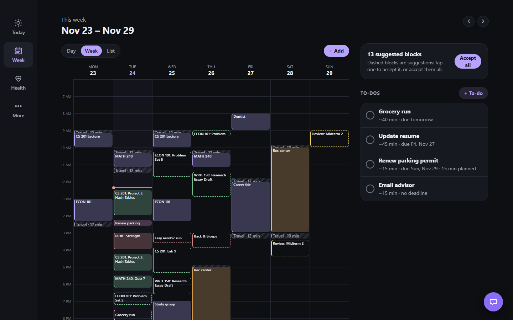
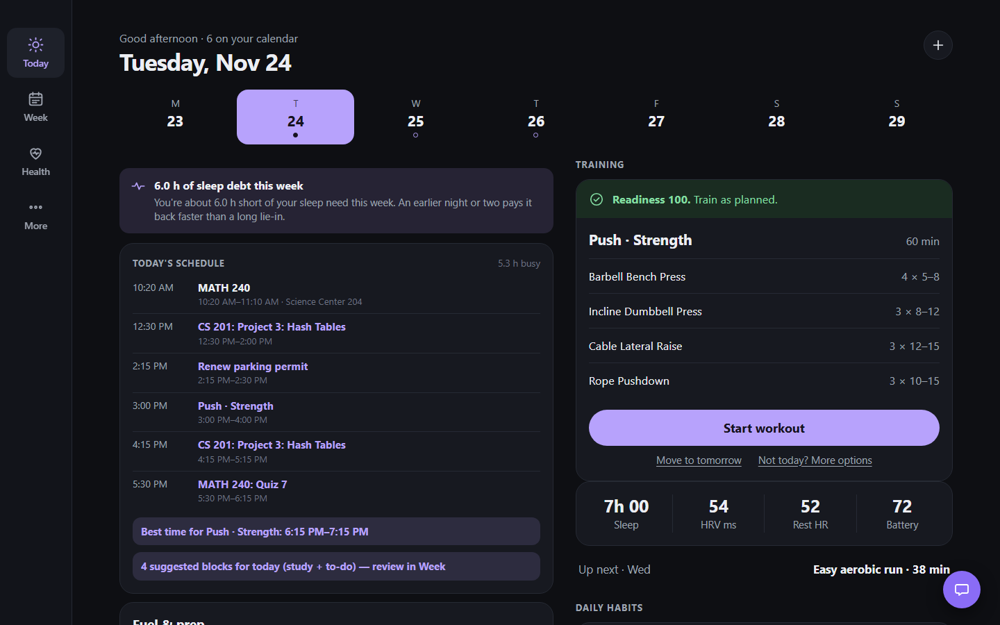
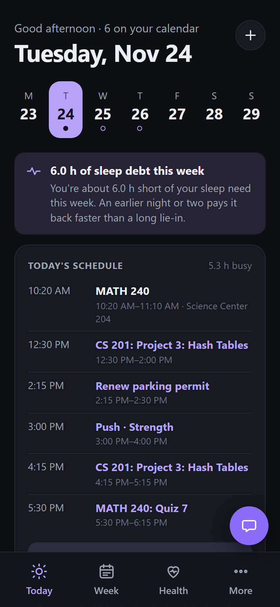

# Compass

**A local-first life planner that schedules a student's week around classes, work, and training.**

Compass pulls in school and personal calendars, a work schedule, assignments, and a lifting and running
program. It then plans the open time: when to study, when to work out, and when to do errands, while
leaving room to travel between places. It syncs the plan back to Outlook, reads recovery data from a
Garmin watch, and has a chat assistant (typed or spoken) that can rearrange the week. Nothing changes
until you confirm.

I built it to run my own week as a student working toward a marathon, and I use it every day.



<table>
  <tr>
    <td width="68%"></td>
    <td width="32%"></td>
  </tr>
</table>

<sub>Screenshots use made-up demo data.</sub>

## What it does

**Planning**
- **One calendar:** combines read-only school calendars (ICS), a personal Outlook calendar, its own events and to-dos, and work shifts that change between semesters and breaks.
- **Draft schedule:** suggests blocks for assignments (by deadline, split into 30–90 min sessions, capped per day), exam review, to-dos, and workouts in your preferred window. You accept them with one tap.
- **Done/missed check-in:** a missed block is rescheduled automatically before its deadline.
- **Travel time:** event locations are matched to saved places, and drive/walk strips are added between them, including parking spots with walk-in times. Compass warns when two back-to-back events are too far apart.
- **Moving your own events when needed:** when a deadline can't fit, it can suggest moving one of your movable Outlook events. School events are never touched.

**Training**
- **Training blocks:** generates lifting and running blocks (build, deload) and full marathon plans that taper to race day.
- **Rescheduling:** move, skip, push back, or swap workouts, with a preview. It warns about bad spacing, like a long run the day after legs.
- **Daily readiness:** a transparent rules engine using sleep, HRV, resting HR and how you feel. See [How readiness works](#how-readiness-works).
- **Workout logging:** an active-workout screen with progression suggestions, a rest timer and lift history.
- **Fuel and prep:** cards that scale with the next long or hard run.

**Assistant**
- **Chat or voice:** "swap Tuesday and Wednesday's workouts", "push my plan back two days", "add a to-do to email my advisor by Friday".
- **Built-in commands:** common requests are handled without an AI model.
- **Confirm before changing anything:** everything else goes to an LLM (Groq, xAI, or Gemini; free tiers work) through tool calls that only *propose* changes. Each proposal is validated, previewed and applied only after you confirm, with one-step undo.

## Engineering highlights

- **Two-way Outlook sync without duplicates:** accepted blocks are written to the Microsoft Graph calendar using a link table with content fingerprints. Each sync creates, updates or deletes only what changed, recreates events you deleted in Outlook, and is serialized with a lock so overlapping syncs can't double-book.
- **Reading another app's data safely:** assignments come from a separate desktop to-do app. Compass parses that app's source with `ast` and runs *only* the assignments that build its task list in a sandbox. It never imports or runs the app, and never writes to its files.
- **Rate-limited Garmin sync:** paced requests, exponential backoff that respects `Retry-After`, per-day commits so a failure keeps partial progress, and raw responses stored so derived columns can be rebuilt without calling the API again.
- **Calendars that are messy in practice:** repeating events with exceptions, all-day events that block the whole day, timezone-aware ICS expansion, and splitting off a single occurrence of a repeating event when you edit it.
- **SQLite under concurrency:** background syncs, the planner and the chat share one database. Writes are committed before any network call so long requests never hold the database lock.
- **Self-hosted and private:** runs on an old laptop as a startup service, reachable only through a private Tailscale network over HTTPS, with nightly backups. Secrets are encrypted with Windows DPAPI and never stored in the repo.

## Tech stack

| Layer | Choice |
| --- | --- |
| Backend | Python, FastAPI, SQLite |
| Frontend | Plain HTML, CSS and JavaScript (no build step), installable as a PWA |
| Integrations | Microsoft Graph (MSAL), Garmin Connect Personal API, ICS feeds, OpenStreetMap (Nominatim + OSRM), OpenAI-compatible LLM APIs |
| Testing | pytest, 120 tests with fake transports for Graph, Garmin, routing and the LLM |
| Hosting | Windows Task Scheduler service + Tailscale Serve |

## Architecture

```text
compass/
├── app.py              # FastAPI app and training/health routes
├── core.py             # paths, schema, settings, backups
├── assistant/          # the planner side
│   ├── calendars.py    #   ICS feeds → calendar_events
│   ├── outlook.py      #   Microsoft Graph two-way sync
│   ├── availability.py #   busy time from every source, free slots
│   ├── planner.py      #   draft blocks, accept, done/missed, rescheduling
│   ├── places.py       #   places, travel times, parking, routing
│   ├── schedule.py     #   move / skip / swap / push workouts
│   ├── runprep.py      #   run spacing rules, fuel and prep cards
│   ├── chat.py         #   LLM tool calls → confirmable proposals
│   └── school.py       #   read-only adapter for the school to-do app
├── readiness.py        # readiness rules engine
├── race_plan.py        # marathon / race plan generator
├── garmin_sync.py      # rate-limited Garmin sync
├── static/             # PWA front end
├── scripts/            # demo data, backups, server setup
└── tests/
```

Every source of busy time (school, Outlook, your own events, work shifts, accepted blocks, travel) goes
through one function, `availability.fixed_events`. The planner, the calendar view and the assistant all
work from the same picture of your day.

## Run it

**Prerequisites:** Python 3.11+.

```powershell
git clone https://github.com/masondunham5/compass.git
cd compass
python -m venv .venv
.\.venv\Scripts\Activate.ps1
pip install -r requirements.txt
python scripts/load_demo_data.py      # optional: a small anonymous demo dataset
python -m uvicorn app:app --port 8765
```

Open http://127.0.0.1:8765. Every integration (Outlook, Garmin, the AI assistant) is optional and set up
from **More → Settings**. The app works fully without them.

```powershell
python -m pytest
```

The tests never touch a real database or network. Each one uses a temporary database and fake API
transports.

## How readiness works

The daily training recommendation uses no AI and never changes the schedule on its own. It's a
transparent rules engine:

1. Start at a recovery score of **100**.
2. Subtract points for each signal:
   - Sleep under 7 h (−12) or under 6 h (−30).
   - HRV at least 15% below your rolling Garmin baseline (−20).
   - Resting HR at least 8% above baseline (−15).
   - Garmin stress of 65 or more (−10).
   - Soreness of 6/10 or more (−8), or 8/10 or more (−30).
   - Energy of 5/10 or less (−8), or 3/10 or less (−25).
3. **76–100:** do the planned session. **51–75:** a shortened version (every exercise kept, 2 sets each,
   about 60% of the time). **0–50:** recovery work or rest, with no catch-up volume.
4. Every rule that fired is shown, so the recommendation can be checked.

Baselines use up to 28 prior days. With no Garmin data, the manual check-in still works.

## Privacy

Compass is local-first. Your data lives in one SQLite file on your own machine, which Git ignores. API
keys are in `.env` or encrypted with Windows DPAPI, and are never shown in the UI, logs or errors.
Outlook access uses your own Azure app registration and a device-code sign-in, so Compass never sees
your password.

## License

[MIT](LICENSE)
